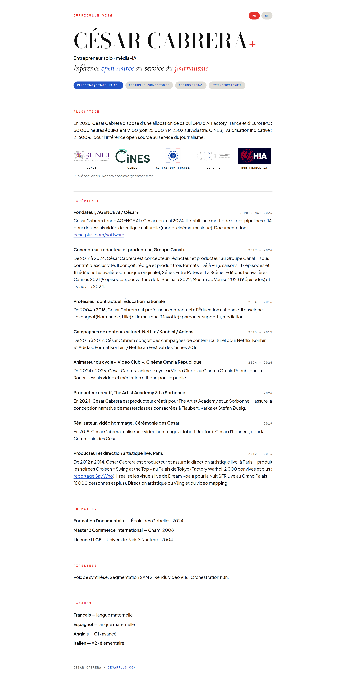
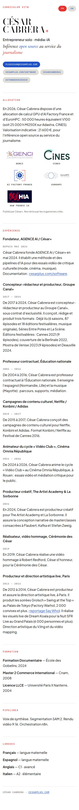

# CÉSAR+ — CV média-IA (version de travail)

**Version de travail, non finalisée.** Ce dépôt sert uniquement à suivre l'avancement de la nouvelle page CV média-IA de César Cabrera (CÉSAR+, AGENCE AI).

- La page est en construction dans une branche de travail du dépôt `cesar-plus`. Les fichiers sont copiés ici tels quels, à chaque étape.
- Rien ici n'est publié sur cesarplus.com ni sur le site GitHub Pages du CV actuel.
- Le contenu (textes, logos, mise en page) peut encore changer.

## Avancement

- 12 nov 2026 : dépôt créé.
- 12 nov 2026 : première version copiée telle quelle depuis la branche de travail `cursor/cv-ia-page-2a11` du dépôt `cesar-plus` : page française `cv-ia/index.html`, page anglaise `cv-ia/en/index.html`, feuille de style `cv-ia/cv.css`, cinq logos dans `cv-ia/assets/logos/`.
- 23 nov 2026 : ajout des programmes startup 2026 (NVIDIA Inception, AWS Activate 10 100 $, Microsoft for Startups 5 000 $ Azure), réorganisation chronologique inverse, mise à jour stack IA / Apple Silicon et ajout du CV ATS 1 page (`cv-ia/Cesar_Cabrera_CV_ATS.pdf`).

## Aperçus

Ordinateur : 

Mobile : 
